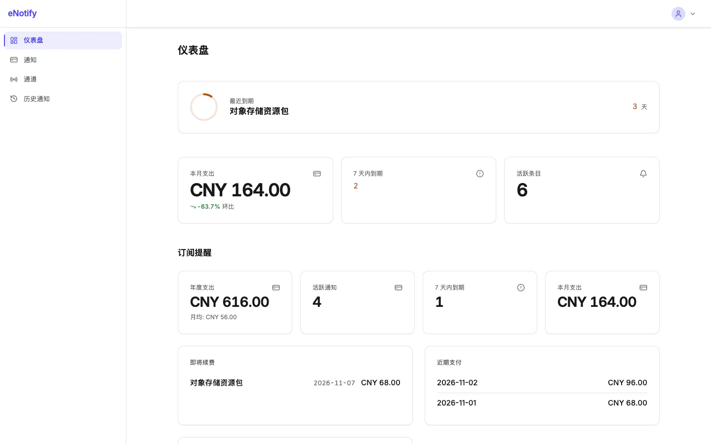
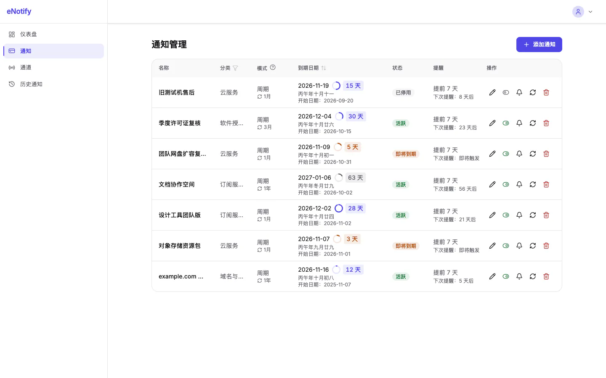
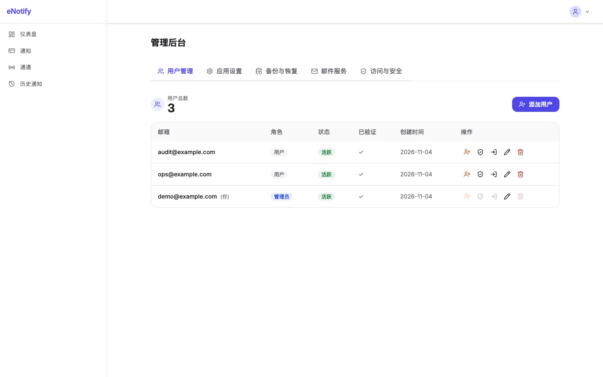

# eNotify

[English](./README.en.md) | 中文

智能通知管理系统，帮助您追踪各类到期事项/提醒事项与费用，并通过多种渠道发送提醒通知。

## 界面预览

<p align="center">
  
</p>

| 通知管理 | 管理后台 |
| --- | --- |
|  |  |

## 功能特性

- **多用户支持** — 注册/登录，首位用户自动成为管理员
- **通知管理** — 添加、编辑、续费、停用，支持周期/重置两种模式，区分普通提醒与订阅提醒
- **自动续费** — 过期订阅自动续期并记录支付历史
- **支付历史** — 记录每笔支付，支持多币种与实时汇率转换
- **仪表盘** — 月度/年度支出统计、到期预警、分类分析
- **8 个通知渠道** — Telegram、Webhook、企业微信、邮件、Bark、Slack、飞书、Discord
- **渠道管理** — 独立页面统一管理通知渠道的启用与配置
- **按项选择渠道** — 每个通知项可单独多选使用哪些渠道，未指定则只使用默认渠道
- **定时提醒** — 每小时自动检查并发送到期提醒，支持全局时段配置和每项独立覆盖
- **通知历史** — 查看所有已发送通知的记录与状态
- **Vikunja 集成** — Vikunja 的任务提醒与逾期事件经 eNotify 默认渠道推送，历史可查
- **两步验证** — TOTP（验证器应用）、邮箱验证码、Passkey
- **密码重置** — 通过邮箱验证码重置密码
- **管理员后台** — 用户管理、系统设置、模拟登录
- **农历支持** — 农历日期显示与周期计算（1900-2100）
- **主题切换** — 浅色/深色/跟随系统
- **双语** — 中文/英文切换
- **移动端适配** — 响应式设计，顶部栏 + 底部导航

## 技术栈

- **后端**: Cloudflare Workers + Hono.js (TypeScript)
- **数据库**: Cloudflare D1 (SQLite)
- **缓存**: Cloudflare KV
- **前端**: React 19 + Vite + Tailwind CSS v4 + shadcn/ui
- **部署**: GitHub Actions + Wrangler

## 部署指南

### 前置要求

- Cloudflare 账户
- GitHub 仓库
- Node.js >= 22
- pnpm

### 1. 创建 Cloudflare 资源

```bash
# 创建 D1 数据库
npx wrangler d1 create enotify-db

# 创建 KV 命名空间
npx wrangler kv namespace create ENOTIFY_KV
```

### 2. 配置 GitHub Secrets

在仓库的 Settings → Secrets and variables → Actions 中添加：

| Secret                 | 说明                                              |
| ---------------------- | ------------------------------------------------- |
| `CLOUDFLARE_API_TOKEN` | Cloudflare API Token（需 Workers 和 D1 权限）     |
| `JWT_SECRET`           | 任意 64 位随机字符串，例如 `openssl rand -hex 32` |
| `SETUP_SECRET`         | 任意随机字符串，例如 `openssl rand -hex 16`       |
| `WAKER_SIGNING_KEY`    | **必需**，waker 回调验签密钥——整点扫描的唯一调度入口（见「定时调度与 waker」） |

在 Settings → Secrets and variables → Actions → Variables 中添加：

| Variable           | 说明                                                                                                                     |
| ------------------ | ------------------------------------------------------------------------------------------------------------------------ |
| `D1_DATABASE_NAME` | D1 数据库名称                                                                                                            |
| `D1_DATABASE_ID`   | D1 数据库 ID                                                                                                             |
| `KV_NAMESPACE_ID`  | KV 命名空间 ID                                                                                                           |
| `TABLE_PREFIX`     | 数据库表前缀，三态：未设置/留空 → 默认 `enotify`（表名如 `enotify_users`）；设为 `none` → 无前缀；其他值（如 `eNotify`）→ 原样 |

### 3. 部署

推送到 `main` 分支即可自动部署。

### 4. 初始化数据库

部署完成后，使用 curl 发送 POST 请求初始化数据库（secret 放在请求头，避免出现在 URL / 浏览器历史 / 访问日志中）：

```bash
curl -X POST https://your-worker.workers.dev/api/setup \
  -H "X-Setup-Secret: <SETUP_SECRET>"
```

每次升级部署后可再次调用一次，以执行数据库迁移（数据库已初始化时会自动运行迁移）。

> 旧的 `GET /api/setup/<SETUP_SECRET>` 地址已废弃（返回 405）。如果你曾通过旧 GET 地址访问过部署，建议轮换 `SETUP_SECRET`，因为 secret 可能已泄露到浏览器历史或访问日志中。

`POST /api/setup` 按来源 IP 限流：每 10 分钟最多 3 次，超限返回 `429`。

setup 页面开关由系统设置 `setup_page_enabled` 控制（`'0'` 关闭 / `'1'` 开启，默认 `'1'`），可在管理后台修改。它**只影响 setup 页面**，`POST /api/setup` 无论开关状态都照常工作。前端可调用无需鉴权的公开接口 `GET /api/setup/state` 获取 `{"enabled": true|false}`（未初始化时返回 `true`）。

已登录的管理员也可以直接调用 `POST /api/admin/setup` 完成初始化/迁移，无需 `SETUP_SECRET`（setup 页面由前端提供）。

### 5. 注册管理员

访问应用首页注册账号，第一个注册的用户将自动成为管理员。

## 本地开发

```bash
# 安装依赖
pnpm install

# 启动开发环境（前后端同时）
pnpm dev

# 仅启动前端
pnpm dev:web

# 仅启动后端
pnpm dev:worker
```

## API Key（外部程序调用）

外部程序（如 AI 助手、脚本）可以用 API Key 调用事项管理接口 `/api/items/*` 与推送触发接口 `/api/notify`，无需 cookie 登录。API Key 的权限与创建它的用户自己的登录态一致；目前仅 `/api/items` 与 `/api/notify` 支持 API Key，其余接口（含 key 管理本身）仍只认登录会话。

> 日常管理可直接在网页的 **设置 → API 密钥** 里完成：生成、复制、查看和吊销。下面的 curl 示例适合脚本化或排查问题。

**1. 生成**（需先登录，使用 cookie 会话）

```bash
curl -X POST https://your-worker.workers.dev/api/me/api-keys \
  -H "Content-Type: application/json" \
  -H "Cookie: access_token=<登录后的 access_token>" \
  -d '{"name": "my-assistant", "expires_in_days": 90}'
```

`name` 必填（1-50 字符）；`expires_in_days` 可选，1-3650，默认 365。每个用户最多 20 个 key。响应中的 `key`（形如 `enk_...`）**只会出现这一次**，服务端只保存其 SHA-256 哈希，丢失后只能重新生成。

**2. 使用**

```bash
curl https://your-worker.workers.dev/api/items \
  -H "Authorization: Bearer enk_xxxxxxxx"

curl -X POST https://your-worker.workers.dev/api/items \
  -H "Authorization: Bearer enk_xxxxxxxx" \
  -H "Content-Type: application/json" \
  -d '{...}'

curl -X POST https://your-worker.workers.dev/api/notify \
  -H "Authorization: Bearer enk_xxxxxxxx" \
  -H "Content-Type: application/json" \
  -d '{"title": "提醒", "body": "内容", "url": "https://example.com"}'

# 多选 Telegram 和 Bark，其他渠道不发送
curl -X POST https://your-worker.workers.dev/api/notify \
  -H "Authorization: Bearer enk_xxxxxxxx" \
  -H "Content-Type: application/json" \
  -d '{"title": "提醒", "body": "内容", "channels": ["telegram", "bark"]}'
```

`POST /api/notify` 请求体可带可选 `channels` 数组多选渠道；不带或为空数组时只发该用户的默认渠道。`channels` 含未知或未启用渠道、或未设默认渠道时返回 400 且不发送。`title` 省略时默认为 `Notification`。该接口除了 API Key 也接受 cookie 登录态。

每个 key 限流 120 次/分钟，超出返回 `429`。key 无效、过期或已吊销时返回 `401`；对应用户被禁用后其 key 立即失效。`/api/notify` 另有一层按 IP 的 30 次/分钟限流。

旧的 notify token（`/api/notify/<token>`）已下线，返回 `410`，请改用 API Key 调用 `POST /api/notify`。

**3. 查看与吊销**（同样需要登录会话）

```bash
# 列出（不含明文，含 last_used_at，最多约 5 分钟延迟）
curl https://your-worker.workers.dev/api/me/api-keys -H "Cookie: access_token=..."

# 吊销，立即生效
curl -X DELETE https://your-worker.workers.dev/api/me/api-keys/<id> -H "Cookie: access_token=..."
```

## Vikunja 集成（入站 webhook）

用户自托管的 [Vikunja](https://vikunja.io) 可以把任务提醒与逾期事件推给 eNotify，由 eNotify 的默认渠道（与 `POST /api/notify` 相同的默认渠道语义）扇出；每次推送都会以来源 `vikunja` 记入通知历史。

**升级后先应用迁移。** 本功能依赖 `schema_v4` 新建的 `{prefix}vikunja_integrations` 表：部署新版本后，管理员需在后台执行一次「检查并升级数据库」（或调用 `POST /api/setup` / `POST /api/admin/setup`）把迁移补到 `schema_v4`。就地过渡的存量库第一次只打戳 `schema_v1`，需要再点一次补齐 `schema_v2`–`schema_v4`。

**前置：在 Vikunja 服务端开启 webhooks。** 该功能由配置项 `webhooks.enabled` 控制（默认开启）；若实例已关闭，需在 `config.yml` 里设置 `webhooks.enabled: true`（或环境变量 `VIKUNJA_WEBHOOKS_ENABLED=true`）并重启服务，账户设置里才会出现 Webhooks 入口。每个用户在自己的 Vikunja「设置 → Webhooks」中新建 webhook，填入下面生成的地址与 secret。

**1. 创建集成**（需登录，cookie 会话）

```bash
curl -X POST https://your-worker.workers.dev/api/me/integrations/vikunja \
  -H "Content-Type: application/json" \
  -H "Cookie: access_token=<登录后的 access_token>" \
  -d '{"base_url": "https://vikunja.example.com"}'
```

`base_url` 可选，用于拼推送里的任务链接 `{base_url}/tasks/{task.id}`（留空则不带链接）。响应中的 `secret` **只出现这一次**，请填入 Vikunja webhook 的 Secret 字段，丢失只能轮换。`hook_token` 可以回显，用来拼入站地址：

`https://your-worker.workers.dev/api/integrations/vikunja/<hook_token>`

每个用户只有一个集成（重复创建返回 409）。管理接口（鉴权与 `/api/me/api-keys` 一致，仅认登录会话）：

| 方法与路径 | 说明 |
| --- | --- |
| `POST /api/me/integrations/vikunja` | 创建；201 返回 `hook_token` 与一次性 `secret`；已存在 409 |
| `GET /api/me/integrations/vikunja` | 查询；未创建返回 `{configured:false}`，**永不返回 secret 明文**（只有 `secret_configured:true`） |
| `PUT /api/me/integrations/vikunja` | 修改 `enabled`（布尔）与 `base_url`（须 `http://` 或 `https://`，自动去尾斜杠，空串表示清空） |
| `POST /api/me/integrations/vikunja/regenerate-secret` | 轮换 secret，仅此一次返回新明文；未创建 404 |
| `DELETE /api/me/integrations/vikunja` | 删除集成；删除后入站请求返回 404；未创建 404 |

**2. 在 Vikunja 里建 webhook**

- Target URL：上面的入站地址；
- Secret：创建或轮换时拿到的 secret；
- 事件：只勾 `task.reminder.fired`（提醒到点）与 `tasks.overdue`（逾期汇总）。`task.overdue` 与 `tasks.overdue` 内容重叠，同时勾选会收到两条，建议只留汇总。

**3. 入站约定**

- 端点：`POST /api/integrations/vikunja/:hookToken`，不使用会话或 API Key，只认 HMAC 验签。
- 验签：Vikunja 对未解析的请求 body 计算 HMAC-SHA256，放在 `X-Vikunja-Signature` 头（hex 小写）；eNotify 用该集成对应的 secret 做常量时间比对。签名头缺失、格式不合或比对失败一律 `401 {"error":"Invalid signature"}`。
- 事件：已适配 `task.reminder.fired`、`task.overdue`、`tasks.overdue` 三个 User webhooks 事件；其他 `event_name` 返回 200 `{ignored:true}` 且不发送。
- 发送语义与 `/api/notify` 一致：只发默认渠道；未设默认渠道返回 400 且不发送；不做通知时段门控；不创建 eNotify 事项；不去重；等发送完成才回响应（`200 {success:true, results}`）。
- 状态码：hookToken 不存在 404、集成已停用 403、验签失败 401、body 非 JSON 或缺 `event_name` 400、已知事件但 data 缺关键字段 200 `{ignored:true}`（仅记日志）、未知事件 200 `{ignored:true}`。按 hookToken 限流 60 次/分钟。

## 环境变量

### Worker 环境变量

`JWT_SECRET` 和 `SETUP_SECRET` 是 Secret，由 GitHub Actions 通过 `wrangler deploy --secrets-file` 上传；本地部署请先执行 `wrangler secret put JWT_SECRET`（`SETUP_SECRET` 同理）。`TABLE_PREFIX` 在 wrangler.toml 中注入。

`TABLE_PREFIX` 为三态语义（在 `worker/src/types.ts` 的 `getTablePrefix()` 中统一解析，全仓唯一解析点）：

- **未配置**（未设置 / `null`）→ 默认前缀 `enotify`，实际表名如 `enotify_users`；
- **自定义非空值**（如 `eNotify`）→ 原样使用并自动补尾 `_`（`eNotify_`），仅允许字母/数字/下划线；
- **显式空字符串 `""`** → 无前缀，表名不带前缀（如 `users`）。

CI 部署约定（`.github/workflows/deploy.yml`）：GitHub Variables 中的 `TABLE_PREFIX` 未设置或为空 → 注入 `enotify`；设为保留字 `none` → 注入空字符串（无前缀）；其他值 → 原样注入。与运行时三态解析保持一致。

> ⚠️ **升级警告**：历史上从未配置过 `TABLE_PREFIX` 的旧部署（旧版默认无前缀）升级到本版本前，须先在 GitHub Variables 中显式配置 `TABLE_PREFIX=none` 保持原表名；否则初始化/迁移接口（`POST /api/setup`、`POST /api/admin/setup`）会检测到无前缀存量 schema 与新默认前缀 `enotify_` 冲突并中止（409 `PREFIX_CONFLICT`，绝不自动重建表）。配置为自定义值（如 `eNotify`）的存量部署不受影响。

| 变量           | 说明                                                                                                                     |
| -------------- | ------------------------------------------------------------------------------------------------------------------------ |
| `JWT_SECRET`   | JWT 签名密钥，任意 64 位随机字符串                                                                                       |
| `SETUP_SECRET` | 数据库初始化路由密钥，任意随机字符串                                                                                     |
| `TABLE_PREFIX` | 数据库表前缀，三态：未设置 → 默认 `enotify`（表名如 `enotify_users`）；显式空串/CI `none` → 无前缀；自定义值 → 原样补尾 `_` |
| `WAKER_SIGNING_KEY` | **必需**。waker 回调验签密钥（整点扫描的唯一调度入口）；缺失/空白/`*_PLACEHOLDER` = 未配置，CI 互锁会拦住部署 |

## 定时调度与 waker

每小时提醒扫描由 [waker](https://github.com/WorkerHub/waker) 平台的 `hourly-reminder-sweep` 任务驱动，**唯一需要配置的只有 `WAKER_SIGNING_KEY`**。`worker/wrangler.toml` 里没有原生 Cron Trigger（`[triggers]` 保留、`crons = []`），Cloudflare 侧没有 cron、槽位已释放；没有这个 key 整点就没有任何调度入口，所以 CI 互锁会在缺 key 时直接让部署失败。

> 为什么是 `crons = []` 而不是删掉 `[triggers]` 段：按 [Cloudflare 文档](https://developers.cloudflare.com/workers/wrangler/configuration/#triggers)，注释或删除 `crons` 键**不会**停用已存在的 Cron Trigger，只有显式写空数组才会清掉它（wrangler 仅在 `crons` 有定义时才 PUT `/schedules`）。

> 回调的验签、时间窗与 executionId 幂等由官方 SDK 源码拷贝（`worker/src/waker/`，`@workerhub/waker-client` 2.0.0）负责，本仓不自己实现协议；该目录不得手改。

### 1. 配置签名密钥（必需）

在仓库 Settings → Secrets and variables → Actions 增加 Secret `WAKER_SIGNING_KEY`（值 = waker 控制台建项目时**一次性展示**的 signing key，先在密码管理器留底）。部署时它只写入 `$RUNNER_TEMP/secrets.json`（0600）再经 `wrangler deploy --secrets-file` 上传；CI 只打印 `configured` / `not configured` 状态，**永不打印值**。

空值、纯空白、`undefined` 与以 `_PLACEHOLDER` 结尾的值一律视为「未配置」。未配置时 receiver 仍然挂载、但 fail closed：真回调返回 **500 JSON `signing_key_missing`**，缺签名头返回 400，`GET /_waker/execute` 返回 404——**绝不会落到 SPA 的 200 HTML**，也不会查库、写账本或触发业务。此时 `[triggers]` 的 `crons` 也是空的，CI 会在部署前直接失败（防「两个调度都没了」的静默停跑）；本地 `pnpm deploy` 不经过这道互锁，部署前先确认 Secret 已配置。

### 2. 在 waker 控制台建任务

新建项目 `eNotify`（回调地址填本站生产域名，平台自动补 `/_waker/execute`），再建一个声明式任务：

| 字段 | 值 |
| --- | --- |
| 任务名 | `hourly-reminder-sweep`（必须与代码里的 `WAKER_JOB_NAME` 逐字一致，否则回调 404 `unknown_job`） |
| 类型 | cron |
| cron | `0 * * * *` |
| 时区 | `UTC` |
| payload | `{}` |
| misfire | `fire_once` |
| concurrency | `forbid` |
| maxRetries | `2` |
| backoffSeconds | `30` |
| timeoutSeconds | `300` |
| jitterSeconds | `0` |
| enabled | `true` |

本仓不提供注册客户端、不存放项目令牌、不做动态注册/取消/自续：任务只在控制台手工维护。回调 handler 会**同步等业务跑完**才回 2xx，失败由平台按策略重试（同一 executionId 重试不会重复执行）。

### 3. 数据库迁移

`schema_v3` 在项目的表前缀下新建两张表（默认 `enotify_waker_executions`、`enotify_scheduler_tick_claims`）：前者是 SDK 的 executionId 幂等账本，后者是整点认领表。升级部署后照常调一次 `POST /api/setup`（或管理面「检查并升级数据库」）即可；迁移只增不改、幂等可重跑。键已配但认领表还没建时，waker 入口会安全停跑（认领先于发送，不重复发送优先），所以**先迁移再配 key**。

### 4. 当前状态、回退与停用

- **当前状态：waker 独占**：`worker/wrangler.toml` 保留 `[triggers]` 但 `crons = []`（显式置空才真正清掉 Cloudflare 侧的 Cron Trigger），整点扫描只由 waker 任务 `hourly-reminder-sweep` 驱动。
- **回退到双跑 / 纯 cron**：把 `worker/wrangler.toml` 的 `crons` 改回 `["0 * * * *"]` 并部署。两个入口并存时每个 UTC 整点只有一个入口在 D1 里认领成功并真正跑扫描，另一侧直接跳过（waker 侧响应 `duplicate_tick`），所以不会重复推送/重复续期；认领行保留 7 天用于排障。
- **停用回调**：`wrangler deploy --secrets-file` 是增量语义（省略某个键不会删除旧值），所以要先恢复 `crons = ["0 * * * *"]` 再部署，并显式执行 `npx wrangler secret delete WAKER_SIGNING_KEY`。即使忘记删，整点认领也保证不会重复执行。
- **轮换 key**：在 waker 控制台轮换 → 旧 key 立即失效 → 更新 GitHub Secret `WAKER_SIGNING_KEY` → 重新部署。轮换窗口内的回调会因验签失败被拒（401），平台按策略重试。
- **手动触发 / 死信重放**：平台对这类执行下发的是「投递时刻」而不是整点槽位（waker `manualTrigger` / `replayDeadLetter`），所以它们**不占用整点认领**，直接跑一轮扫描；executionId 已由 SDK 账本去重、提醒与续期仍有 KV 去重，因此不会重复推送。控制台的「立即执行」是真实运行（响应体 `trigger: "manual"`，执行日志里 `executed: true`），不是被 cron 认领吞掉的静默 no-op。
- **超时 / 崩溃**：平台在 `timeoutSeconds` 后中断请求时没有机会释放认领，重试（同一 executionId）会在 20 秒后接管 SDK 账本占位与 `source=waker` 的整点认领，把这一小时补完；cron 的认领**永不**被接管（它没有重试，重跑会重复发送）。

## 许可证

[MIT](LICENSE)
